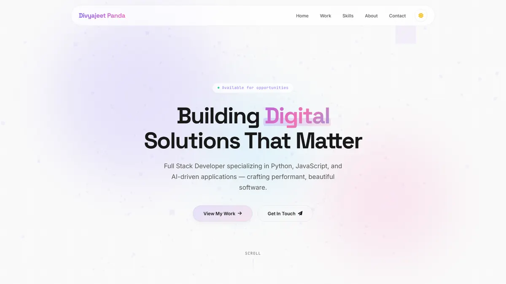
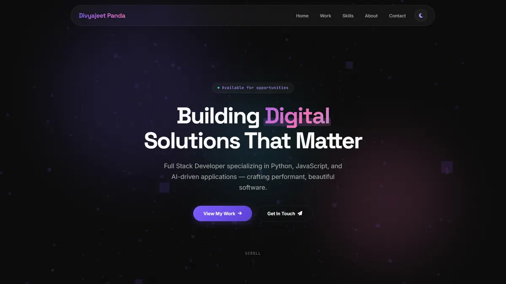

# Divyajeet Panda — Portfolio

Personal site for my work as a software engineer on backend and data systems.

**Live:** [divyajeet.netlify.app](https://divyajeet.netlify.app)


[](https://app.netlify.com/sites/divyajeet/deploys)

## What's on the site

- **Hero** with an interactive 3D character (Three.js + a `.glb` model) that idles, follows the cursor, and waves when you start scrolling or tap "Hello"
- **About** and **What I do**: backend & data, graph & AI, with each skill linked to the job, project or certificate that backs it
- **Experience** timeline
- **Personal projects**: Olist Query Studio, Bug2JSON, Sort-Downloads and others, each with a data-flow diagram and, where public, a screenshot and code link
- **Certifications**: Microsoft Applied Skills, Neo4j, HackerRank and Udemy, with links to verify each one
- **Resume** preview and PDF download
- **Education & awards**, including the gold medal card that shows convocation photos on hover
- **Contact** form (Netlify Forms) with an animated name heading, plus a back-to-top button
- **On phones**, a bar with Resume and Email buttons stays at the bottom of the screen

The site uses an orange (`#ff5b2e`) accent on neutral black, Geist and Geist Mono fonts, and GSAP ScrollTrigger reveals. If the browser asks for reduced motion, the animations are turned off.

## Stack

Plain HTML, CSS and JavaScript. Nothing gets built at deploy time.

| Area | Used |
|------|------|
| Markup & styles | `index.html`, `css/site.css` |
| Scripts | `js/site.js` (page behaviour), `js/avatar.js` (3D avatar) |
| Libraries (self-hosted) | GSAP 3.12.5 + ScrollTrigger, Three.js + GLTFLoader |
| Hosting | Netlify (auto-deploys from `main`), cache and security headers in `_headers` |
| Search & sharing | Open Graph card (`img/og-card.png`), JSON-LD `Person`, `robots.txt`, `sitemap.xml` |

## Running locally

```bash
git clone https://github.com/Divyajeet7978/Portfolio_Redesigned.git
cd Portfolio_Redesigned
npx serve .   # or any static server
```

Use a local server, not `file://`. The browser blocks the avatar model from loading over `file://`.

## Project structure

```
├── index.html
├── css/site.css          # Design tokens, layout, animations
├── js/site.js            # Reveals, nav, contact form, effects
├── js/avatar.js          # Three.js avatar
├── img/                  # Project images, photos, avatar.glb, og-card.png
├── fonts/                # Self-hosted font subsets
├── vendor/               # GSAP and Three.js
├── Divyajeet_Panda_Resume.pdf
├── robots.txt, sitemap.xml
└── _headers              # Netlify cache and security headers (CSP)
```

## Milestones

### v1: glassmorphism build (up to September 2026)

The previous version used an indigo/purple glassmorphism design and a light/dark theme switcher, with a particle canvas behind it.

<div align="center">
  
  
</div>

### v2: current redesign (October 2026)

Rebuilt with an orange-on-black look, a 3D avatar in the hero, edge-glow cards and rewritten copy. See it [live](https://divyajeet.netlify.app).

## Credits

3D character: [Hoodie Character](https://poly.pizza/m/gKLBoRsyKe) by Quaternius (public domain, CC0).

## Contact

divyajeetpanda@outlook.com
